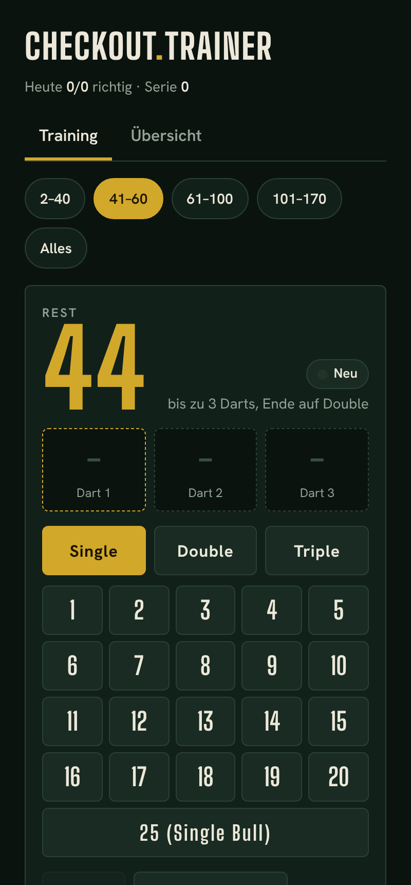

# Checkout-Trainer

Eine kleine Web-App zum Lernen von Darts-Checkouts (Steel Darts, Double Out): Sie zeigt einen Restscore von 2 bis 170, du tippst bis zu drei Darts ein, und sie sagt dir, ob dein Weg funktioniert.



## Funktionen

- **Jeder gültige Weg zählt:** Die Summe stimmt und der letzte Dart ist ein Double oder Bull.
- **Standardweg als Vergleich:** Weicht dein Weg ab, wird der Standardweg zusätzlich gezeigt.
- **„Nicht checkbar":** 159, 162, 163, 165, 166, 168 und 169 gehen mit drei Darts nicht.
- **Lernboxen nach dem Leitner-System:** Richtig heißt eine Box höher (bis Box 5), falsch heißt zurück auf Box 1. Zahlen in niedrigen Boxen kommen häufiger dran, dieselbe Zahl nie zweimal direkt hintereinander.
- **Zahlenbereiche:** 2–40, 41–60, 61–100, 101–170 oder alles.
- **Tipp-Knopf:** zeigt den ersten Dart des Standardwegs. Mit Tipp gibt es keine neue Box.
- **Tageszähler:** „Heute x/y" beginnt um 0 Uhr neu. Die Serie zählt richtige Antworten in Folge, auch über mehrere Tage, und fällt bei einem Fehler auf 0.
- **Übersicht:** alle Wege nach Box eingefärbt, wie viele Zahlen schon sitzen, Fortschritt zurücksetzen.

## Nutzung

[`checkout-trainer.html`](checkout-trainer.html) herunterladen und im Browser öffnen. Die Datei enthält alles, auch die Schriften, und funktioniert ohne Internetverbindung.

Hinweis: Der Browser speichert den Fortschritt passend zum Ort der Datei. Öffnest du sie später von einem anderen Ort, beginnt der Fortschritt von vorn.

## Datenschutz

Die App lädt nichts nach und sendet nichts. Der Lernfortschritt liegt nur lokal in deinem Browser (`localStorage`, Schlüssel `checkout-trainer-v1` für Boxen und Bereich, `checkout-trainer-day-v1` für den Tageszähler). Wer die Browserdaten löscht, verliert auch den Fortschritt.

## Hinweis zu den Wegen

Es sind gängige Standardwege, nicht zwingend die für jeden besten Wege.

## Entwicklung

Voraussetzung ist [Node.js](https://nodejs.org/), weitere Abhängigkeiten gibt es nicht.

```bash
node build.js    # setzt src/ und fonts/ zu checkout-trainer.html und docs/index.html zusammen
node test.js     # prüft Bewertung, Lernboxen und Ziehung
node verify.js   # prüft alle Standardwege: Summe, Double am Ende, keine Duplikate, genau die 7 nicht checkbaren Zahlen fehlen
node test-daycount.js  # prüft Tageszähler und Serie (Tageswechsel, Neuladen, defekter Speicher)
```

Die Quellen liegen in `src/`, die Schriften (nur die verwendeten Schnitte, Latin) in `fonts/`. Nach Änderungen `node build.js` ausführen und die gebauten Dateien mit einchecken.

## Lizenz

Code unter der [MIT-Lizenz](LICENSE), Schriften (Big Shoulders Display, Hanken Grotesk) unter der [SIL Open Font License 1.1](fonts/OFL.txt).

Ein privates, nicht-kommerzielles Projekt ohne Gewähr. Es besteht keine Verbindung zu Herstellern, Verbänden, Apps oder anderen Dritten aus dem Dartsport. Entwickelt mit Unterstützung von Claude (Anthropic).

---

## What is this?

A small web app for learning darts checkouts (steel darts, double out). It shows a remaining score from 2 to 170, you enter up to three darts, and it tells you whether your route works. Any valid route counts, the standard route is shown for comparison, and scores you miss come up more often (Leitner boxes). The interface is in German.

Download [`checkout-trainer.html`](checkout-trainer.html) and open it in your browser. It works offline. Your progress stays in your browser (`localStorage`). Nothing is loaded from or sent to anywhere. Code under MIT, fonts under SIL OFL 1.1. A private, non-commercial project, not affiliated with any third party.
